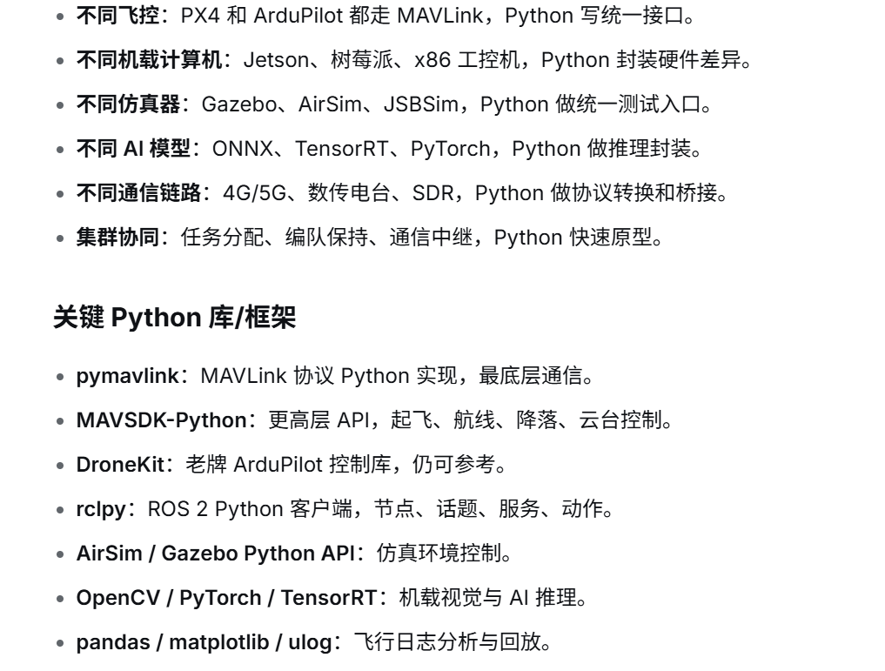

# 需求文档：民用无人机 Python 统一层

| 项 | 内容 |
|----|------|
| 文档类型 | 产品 / 软件需求 |
| 对应代码 | `src/drone_fc`、`examples/`、`tests/` |
| 当前版本 | V1（飞控统一接口已落地） |
| 读者 | 开发、联调、后续扩展 |

本文描述本仓库**要做成什么**、**V1 已验收什么**、**图中其余能力何时做**。实现细节与运行命令见根目录 [README.md](../README.md)。

---

## 1. 背景与目标

多旋翼常用 **PX4** 或 **ArduPilot**，二者都讲 MAVLink，但飞行模式编码、起飞流程不同。上层若直接绑某一 SDK，换固件或换仿真就要改业务代码。

目标：用 **Python 写一层统一接口**，先消化飞控差异，再按同样思路封装机载计算机、仿真器、推理引擎和通信链路。V1 只做飞控这一层，保证能连上、能飞、能读遥测。

范围限定为民用飞行控制（测绘、巡检、科研仿真）。不包含武器投放、目标打击或轰炸调度。

---

## 2. 总体愿景（能力地图）

下面这张图是本项目的分层目标：每一层都用 Python 挡住差异，业务只调统一 API。图中「关键 Python 库」是候选技术，**不等于 V1 已经全部引入**。

图分两块，对应关系如下。

### 2.1 六层统一封装

| 图中条目 | 含义 | 本仓库状态 |
|----------|------|------------|
| 不同飞控：PX4 和 ArduPilot 都走 MAVLink，Python 写一接口 | 应用只调一套起飞 / 航线 / 降落 API | **V1 已实现**（`pymavlink` + 语义 `FlightController`） |
| 不同机载计算机：Jetson、树莓派、x86，Python 封装硬件差异 | CPU / CUDA / 摄像头设备路径等 | 未开始 |
| 不同仿真器：Gazebo、AirSim、JSBSim，Python 做统一测试入口 | 同一套用例在多种仿真里跑 | 未开始；现有为协议级 mock，不是物理仿真 |
| 不同 AI 模型：ONNX、TensorRT、PyTorch，Python 做推理封装 | 同一 `infer()` 换后端 | 未开始 |
| 不同通信链路：4G/5G、数传电台、SDR，Python 做协议转换和桥接 | 把链路收发映射成统一消息 | 未开始；V1 仅 UDP/TCP/串口 MAVLink |
| 集群协同：任务分配、编队保持、通信中继 | 多机民用协同原型 | 未开始 |

### 2.2 关键 Python 库（图中清单）

| 库 | 图中角色 | 本仓库用法 |
|----|----------|------------|
| pymavlink | MAVLink 最底层 | **V1 唯一飞控后端** |
| MAVSDK-Python | 更高层起飞 / 航线 / 云台 | 未引入；统一层已覆盖起飞降落前往 |
| DroneKit | 老牌 ArduPilot 库 | 未引入；模式表按 ArduCopter 编号手写映射 |
| rclpy | ROS 2 客户端 | 未引入 |
| AirSim / Gazebo Python API | 仿真环境控制 | 未引入 |
| OpenCV / PyTorch / TensorRT | 机载视觉与推理 | 未引入 |
| pandas / matplotlib / ulog | 日志分析与回放 | **matplotlib** 用于 2D 遥测图；pandas / ulog 未引入 |

后续选库时优先能接到现有 `FlightController` 上，避免业务直接依赖某一仿真或某一推理框架。

---

## 3. 用户与场景

| 角色 | 场景 |
|------|------|
| 飞控联调人员 | 无真机时用协议模拟验证心跳、解锁、起飞、降落 |
| 应用开发 | 只依赖 `FlightController`，不写 PX4/ArduPilot 分支 |
| 仿真使用者 | 改 URI 即可从 mock 切到 PX4 SITL 或 ArduPilot SITL |

V1 验收场景：

1. 模拟端在 UDP `14540` 发心跳，客户端识别为 PX4 并读到 3D GPS、位置、电压。
2. 起飞到给定相对高，水平前往一点，再降落；可用 2D 图看到东/北轨迹和高度曲线。
3. 模式映射单测覆盖 PX4 位域与 ArduPilot 模式号，不依赖硬件。

---

## 4. V1 功能需求（已实现，作为基线）

编号 **FC-** 表示飞控统一层。除非注明「建议」，均为必须。

### 4.1 连接与识别

| ID | 需求 | 约束 |
|----|------|------|
| FC-01 | 支持 URI：`udp:host:port`、`tcp:host:port`、`serial:device:baud`，以及显式 `udpin` / `udpout` | 端口 [1, 65535]；波特率 [1200, 1000000] |
| FC-02 | `udp:host:port` 默认转为监听（`udpin`），以适配 PX4 SITL 向 14540 发数 | — |
| FC-03 | 在超时内收到 `HEARTBEAT` 并识别 PX4 / ArduPilot | 超时必须 > 0；超时抛明确异常 |
| FC-04 | 忽略本端 GCS 心跳，把后续命令发到飞控的 sys/comp id | — |

### 4.2 控制

| ID | 需求 | 约束 |
|----|------|------|
| FC-05 | 语义模式：`MANUAL`、`HOLD`、`MISSION`、`RTL`、`LAND`、`TAKEOFF`、`GUIDED` | `UNKNOWN` 禁止用于 `set_mode` |
| FC-06 | 未收到心跳禁止解锁 | — |
| FC-07 | 起飞前默认要求 GPS `fix_type >= 3`；仅仿真可 `skip_gps_check=True` | 起飞高度 (0, 100] 米 |
| FC-08 | `takeoff` / `goto` / `land` / `rtl` 在飞控 ACK 后返回，不等待到位 | 调用方用 `telemetry()` 判断到位 |
| FC-09 | `goto`：纬度 [-90, 90]、经度 [-180, 180]、相对高 (0, 500] 米 | PX4 优先 `DO_REPOSITION`，不支持则 GUIDED + 位置设定点 |
| FC-10 | 命令失败抛异常，不静默死循环重试 | — |

### 4.3 遥测

| ID | 需求 | 单位 |
|----|------|------|
| FC-11 | 快照含固件类型、模式、解锁、位置、姿态、电池、GPS | 经纬度：度（WGS84）；高度：相对 Home 米；姿态：度 |
| FC-12 | 尚未收到的字段为 `None`，不编造数据 | — |

### 4.4 仿真与可视化（辅助，非物理引擎）

| ID | 需求 |
|----|------|
| FC-13 | 提供协议级 PX4 模拟端：心跳、GPS、位置、命令 ACK，无需 Gazebo |
| FC-14 | 提供连通检查脚本与起飞降落示例 |
| FC-15 | 提供 matplotlib 2D 图：东/北米轨迹 + 高度–时间 |

---

## 5. 非功能需求

| ID | 需求 |
|----|------|
| NF-01 | 应用只依赖 `FlightController` 抽象，不直接 `import pymavlink` |
| NF-02 | 实现类不保证线程安全，同一连接单线程使用 |
| NF-03 | 公开方法注释写清输入、输出、失败、是否阻塞及合法范围 |
| NF-04 | 模式映射与 URI 解析有不依赖真机的单元测试 |
| NF-05 | Python 3.10+；依赖写在 `requirements.txt` |

---

## 6. 明确不做（本仓库与后续扩展均适用）

- 武器投放、目标打击、摧毁列表、自动出击等作战链路
- V1 不实现图中的机载计算机封装、Gazebo/AirSim 统一入口、推理后端、4G/数传/SDR 桥、多机编队
- 模式表不覆盖固定翼、无人车（仅多旋翼）

---

## 7. 后续版本（对照第 2 节图，未排期）

下列条目来自能力地图，**不是当前交付范围**。落地时仍走「抽象接口 + 可替换后端」，并接到 V1 的 `FlightController`。

| 版本意向 | 图中对应 | 建议验收 |
|----------|----------|----------|
| V2 仿真入口 | Gazebo / AirSim / JSBSim | 同一套起飞用例可切换仿真后端 |
| V3 机载硬件 | Jetson / 树莓派 / x86 | 摄像头与设备路径对业务隐藏 |
| V4 推理 | ONNX / TensorRT / PyTorch | 统一 `infer(image) -> 结果` |
| V5 链路桥 | 4G/5G、数传、SDR | MAVLink 或自定义消息可桥接，不改飞控 API |
| V6 协同 | 任务分配、编队、中继 | 民用多机原型，不包含打击 |

---

## 8. 验收记录（V1）

| 项 | 结果 |
|----|------|
| 模式映射 + URI 单测 | `python -m unittest discover -s tests` 通过 |
| 协议模拟连通 | 识别 PX4，GPS 3D，可读位置与电压 |
| 起飞 / 平移 / 降落 + 2D 图 | `examples/live_telemetry_plot.py` 可跑通 |

变更飞控 API 或图中下一层能力时，应同步改本文第 2、4、7 节。
